<p align="center">
  
</p>

<h1 align="center">Latch</h1>

<p align="center">
  A passcode lock for your Brave or Chrome profile that covers things and <strong>never closes or changes your tabs</strong>.<br>
  Auto-lock, Touch ID, a recovery code, and a Safari-style lock for private windows.
</p>

<p align="center">
  <a href="https://github.com/rajveeerr/latch/actions/workflows/test.yml"></a>
  
  
</p>

<p align="center">
  
</p>

## Why Latch

Most browser lockers work by closing windows or tabs and rebuilding them later, and when that goes wrong you
lose tabs, tab groups and unsaved work. Latch only **covers** things. Nothing is closed, reloaded, discarded,
navigated or edited, and everything it does (covering pages, muting tabs, minimizing windows) is undone when you unlock.
A test fails the build if any code tries otherwise.

It also fixes the things people complain about in other lockers: a forgotten passcode (it has a recovery code),
private windows being skipped (it checks and guides you), and covers that are one DevTools click from removal
(it adds a separate lock window in front of everything). The research behind these choices is in [docs/research.md](docs/research.md).

## Features

- **Passcode lock** for the whole profile, stored as a salted PBKDF2 hash. Wrong guesses are slowed down (5 s, 10 s, 20 s, up to 5 minutes).
- **Recovery code.** A one-time 100-bit code, shown at setup, resets a forgotten passcode from the lock screen. Creating a new one retires the old one.
- **Touch ID unlock (beta).** Unlock with Touch ID or your device passkey through WebAuthn. It is verified locally and hidden where unsupported. Your passcode always works too.
- **Private windows only, like Safari.** Lock just your private windows when you step away and leave everything else open. Latch checks that it is allowed in private windows and walks you through turning it on.
- **Auto-lock** after inactivity (30 seconds to 24 hours), after the browser has been in the background, on browser start, and on screen lock or sleep. Or lock instantly with `Control+Shift+L`.
- **Activity log.** A local history of locks, unlocks and wrong guesses, with a notice in the popup if someone tried while you were away. Clearing it needs your passcode.
- **Covers every page** with an opaque lock screen above dialogs and full-screen video, **pauses** media and **mutes** noisy tabs.
- **Pause protection** for 15 minutes, 1 hour, 4 hours or until you resume. Anything that weakens protection asks for your passcode right where you are.
- **Calm, native-feeling interface** in light and dark, with plain-language settings, a first-run checklist, and a lock screen that shows the time.
- **No network, no accounts, no analytics.** Three permissions: `storage`, `idle`, `alarms`. MIT licensed.

<p align="center">
  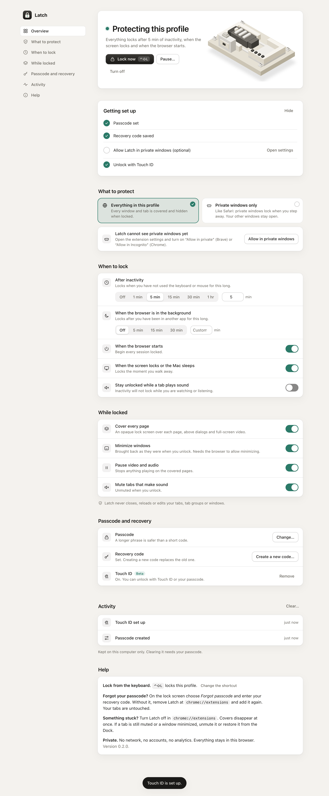
  &nbsp;
  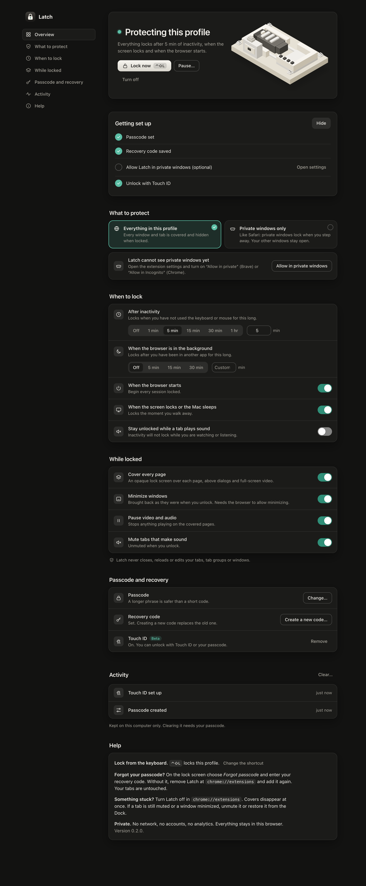
</p>

## A look around

<p align="center">
  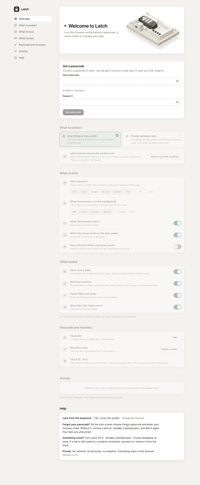
  &nbsp;
  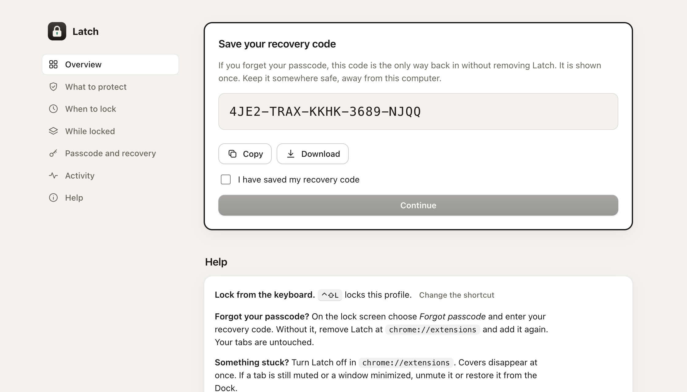
  &nbsp;
  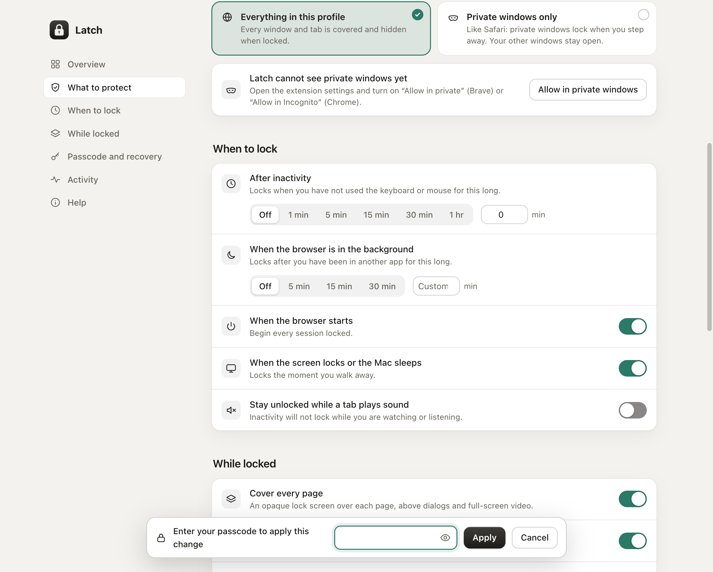
</p>

<p align="center">
  
  &nbsp;
  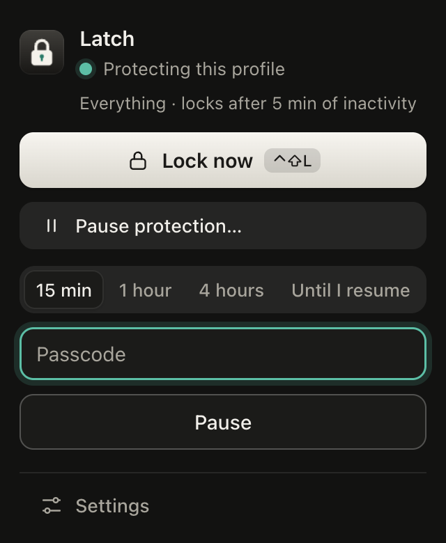
  &nbsp;
  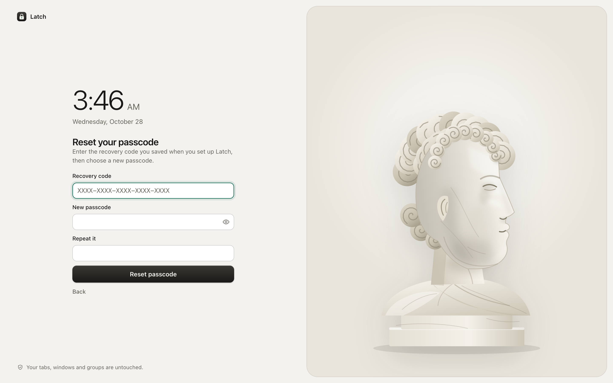
</p>

- **First run asks for one thing.** The rest of the settings wait until a passcode and a recovery code exist.
- **Settings save as you change them,** and a plain sentence at the top always tells you when Latch will lock.
- **Loosening a setting asks for your passcode in place,** and Esc cancels it.
- **The mechanism is the status.** The isometric latch on the overview slides its bolt home when Latch locks.
- **It tells you when it cannot work.** If you choose private windows only but have not allowed Latch in private windows, the overview and the popup say so instead of showing a false "protecting".

<p align="center">
  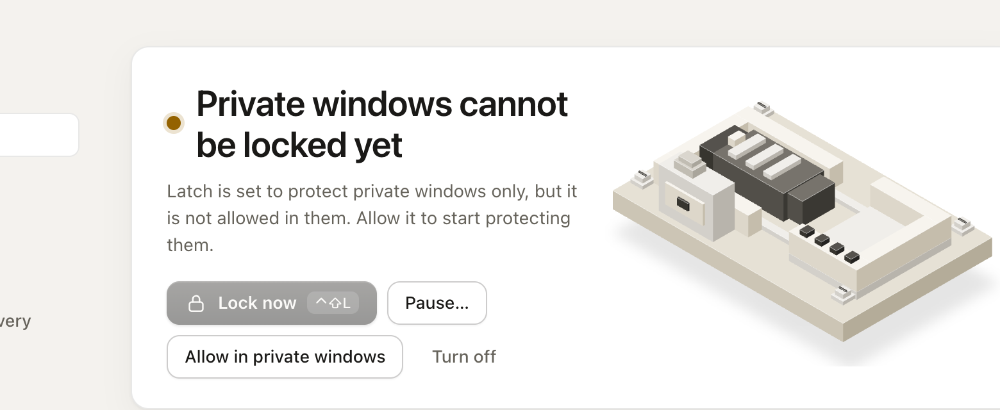
  &nbsp;
  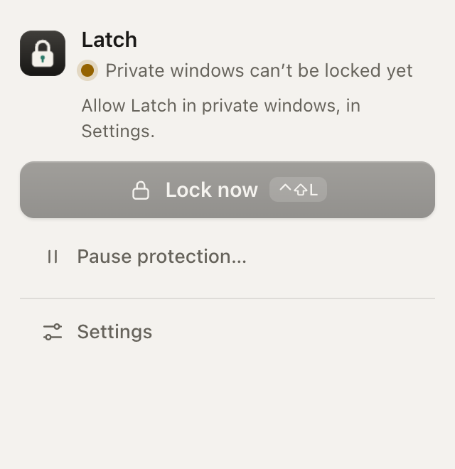
</p>

<p align="center">
  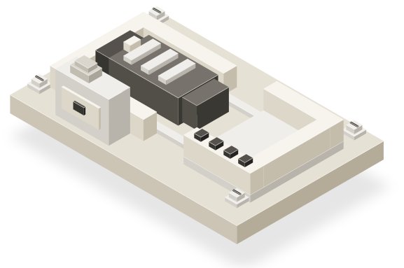
  &nbsp;&nbsp;
  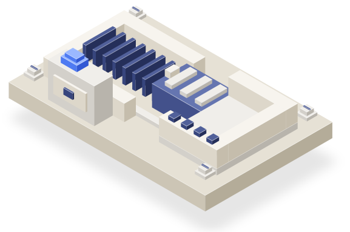
</p>

## Install

Latch is not in a web store yet, so you load it as an unpacked extension. This takes a minute.

1. Download `latch-<version>.zip` from the [latest release](https://github.com/rajveeerr/latch/releases/latest) and unzip it somewhere permanent (the browser reads it from that folder, so do not delete it). Or clone this repo.
2. Open `brave://extensions` (or `chrome://extensions`) and turn on **Developer mode**.
3. Click **Load unpacked** and choose the folder that contains `manifest.json`.
4. The settings page opens. **Set a passcode, then save your recovery code.** Latch does nothing until you do.
5. Pin Latch to the toolbar (puzzle-piece menu) for quick access.
6. Optional: in the extension's details, turn on **Allow in private** (Brave) or **Allow in Incognito** (Chrome) so Latch covers private windows too. The settings page has a button that opens it for you.

Latch locks **the profile it is installed in**. Install it in each profile you want to protect.

## Use

| You want to | Do this |
|---|---|
| Lock right now | Toolbar button, then **Lock now**, or `Control+Shift+L` |
| Unlock | Passcode on the lock screen, or **Use Touch ID** |
| Forgot your passcode | On the lock screen choose **Forgot passcode** and enter your recovery code |
| Lock only private windows | Settings, **What to protect**, then **Private windows only** |
| Change how long until it locks | Settings, **When to lock** |
| Pause protection | Overview, **Pause**, or the toolbar popup |
| See who tried your browser | Settings, **Activity** |
| Change the shortcut | Settings, **Help**, **Change the shortcut** |
| Remove it | `brave://extensions`, then **Remove**. Your tabs are not affected |

## What locking does

<p align="center">
  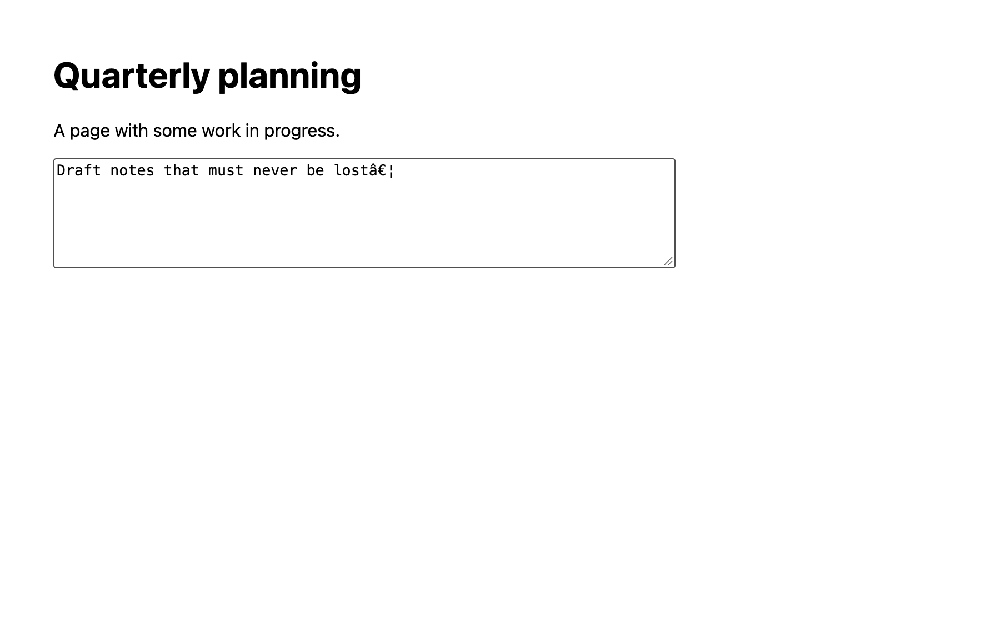
  &nbsp;
  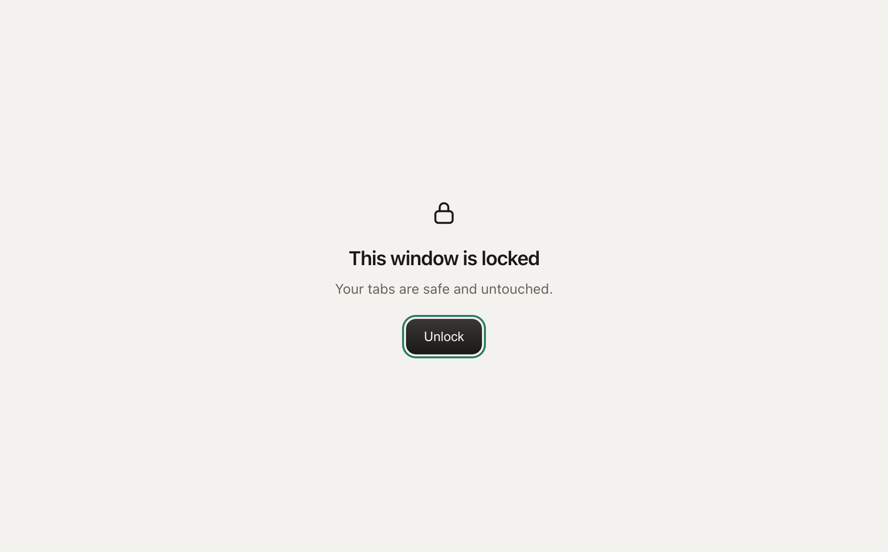
</p>

When Latch locks, in this order: it records the state, covers every page, pauses media, mutes noisy tabs, tries to minimize
your windows, and (in "everything" mode) opens a full-size lock window on top. If you close that window it comes straight back.
If a window appears while locked (new window, session restore) it is hidden too. Unlocking reverses each step and closes only
Latch's own lock window, after checking that it really is that window.

Tab titles, favicons and page titles are never altered. One thing Latch does change: if a page is playing a video full screen,
it leaves full screen so the cover can show.

## Security model, honestly

Latch is a **privacy lock for a browser you leave on a desk**, not a security boundary.

- It stops a casual person walking up to your computer. It does not stop someone with time, skill or a terminal.
- A browser extension cannot hide the tab strip or the address bar. Latch relies on minimizing windows and on the lock window in front. Minimizing is best effort: Chromium and Brave ignored the request in automated tests, so a window may stay visible behind the lock window.
- **"Private windows only" is lighter protection.** It has no lock window in front, only the page cover and minimizing, and a cover can be removed from DevTools. Use "everything" mode when that matters.
- Anyone who can reach `brave://extensions` can remove Latch. While locked it hides or re-covers any window that comes forward, but it cannot make that page unreachable.
- The passcode hash is stored in the profile folder. Someone who copies that folder could try guesses offline. PBKDF2 slows that down, but **use a long passphrase**, not a 4-digit code. The recovery code carries 100 bits and is stored the same way.
- **Touch ID is beta.** The WebAuthn verification is tested with a virtual authenticator in Chromium and Brave. It has not been verified against real Touch ID hardware in Brave, which is why it is labelled beta and falls back to the passcode.
- Anything that can read your disk can read your cookies and sessions without opening the browser. For that, use FileVault and a macOS login password.

## Troubleshooting

**Windows do not minimize when locked.** Some environments ignore the minimize request. Latch still covers every page and puts its lock window in front. Please [open an issue](https://github.com/rajveeerr/latch/issues) with your OS and browser version.

**It did not lock after the inactivity time.** Inactivity means no keyboard or mouse input anywhere on the computer, as reported by the browser's idle API (the shortest time it supports is 15 seconds). If you watch videos without touching anything, turn on *Stay unlocked while a tab plays sound*, or turn it off for a strict timer.

**Private windows are not covered.** Turn on *Allow in private* (Brave) or *Allow in Incognito* (Chrome) in the extension's details. The settings page shows whether it is on.

**A page such as `brave://settings` is not covered.** Extensions cannot draw on browser-internal pages. In "everything" mode they sit behind the lock window.

**I forgot my passcode.** Use **Forgot passcode** on the lock screen with your recovery code. Without it, remove and re-add the extension at `brave://extensions`. Your tabs are untouched.

**Something is stuck.** Turn Latch off at `brave://extensions`. Covers disappear at once. If a tab is still muted, unmute it, and if a window is still minimized, restore it from the Dock. None of it changes your tabs or saved data.

## How it works

- `src/background.js` is the service worker. It decides when to lock, runs the lock and unlock steps one at a time, and only talks to Latch's own pages.
- `src/cover.js` is the content script. It reacts to the stored lock state, builds the cover in a closed shadow root in the top layer, pauses media and swallows key presses.
- `src/lib/auth.js` is the passcode and recovery-code logic (PBKDF2, throttling). `src/lib/webauthn.js` verifies Touch ID sign-ins locally. `src/lib/activity.js` is the capped activity log. `src/lib/settings.js` holds the defaults and the rule for what counts as loosening a setting.
- `ui/` has the lock screen, popup and settings page, the icon sprite, and the two illustrations.
- State that must survive a browser restart lives in `storage.local`. Window and tab ids live in `storage.session`, which the browser clears itself.

The illustrations are code, not images. `ui/art/bust.svg` is built by `scripts/make-bust.mjs` from vector shapes (carved snail-shell curls,
soft tonal planes clipped to the face). The isometric latch is built by `scripts/make-mechanism.mjs`: 45 solid parts, an isometric camera
at 30 degrees, painted back to front, one accent on the lit part. Its bolt, spring and lamp animate between locked and unlocked
(and stand still for anyone who prefers reduced motion).

## Develop

```sh
npm install                # only needed for the e2e test and the screenshot and art scripts
npm test                   # 41 unit tests: passcode, recovery, WebAuthn, settings rules, safety rules
BRAVE=1 npm run test:e2e   # 17 end-to-end checks in real Brave with a throwaway profile
CHROMIUM_PATH=/path/to/chromium npm run test:e2e   # the same, in Chromium
node scripts/make-mechanism.mjs   # regenerate the latch illustration
node scripts/make-bust.mjs        # regenerate the bust
npm run screenshots        # regenerate the README screenshots
npm run zip                # builds dist/latch-<version>.zip
```

The safety test fails the build if any code tries to close, reload, discard or navigate a tab, closes a window other than the lock
window, opens any tab other than Latch's own pages, asks for extra permissions or touches the network. The end-to-end test locks a tab
that is playing audio and has an unsaved draft, then checks the tab, its address, its title and the draft survived.
Idle-based locking and "private windows only" mode depend on real inactivity and a manual browser setting, so they are checked by hand.

## Roadmap

Per-site locks, scheduled locks, a Chrome Web Store release, and real-hardware testing of Touch ID. See [docs/research.md](docs/research.md) for why each is on or off the list.

## Contributing

Issues and pull requests are welcome. Please keep the safety rules above intact, and add a test with any behaviour change.

## License

[MIT](LICENSE)
