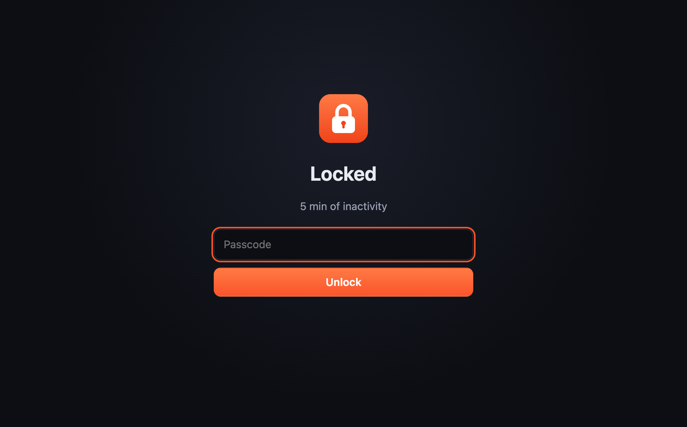
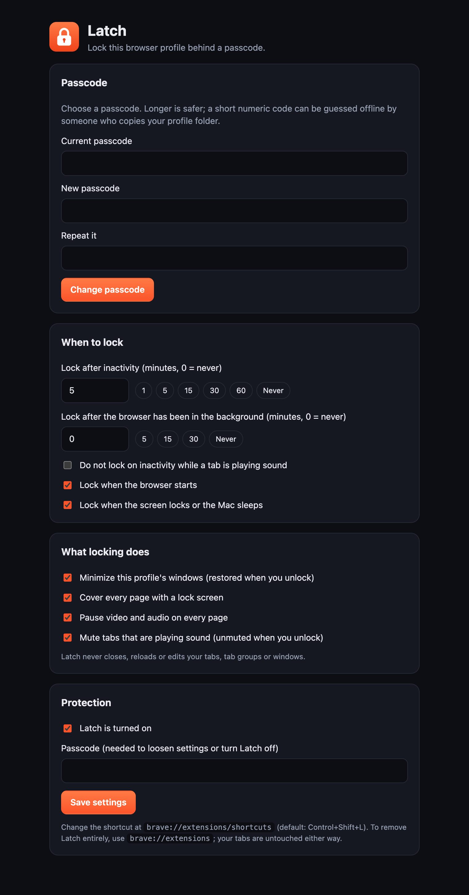
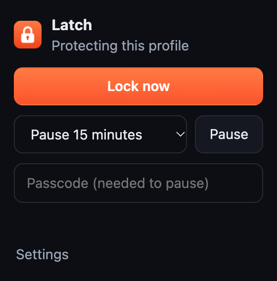

<p align="center">
  
</p>

<h1 align="center">Latch</h1>

<p align="center">
  Lock a Brave or Chrome profile behind a passcode.<br>
  Covers every page, pauses media, and <strong>never closes or changes your tabs</strong>.
</p>

<p align="center">
  <a href="https://github.com/rajveeerr/latch/actions/workflows/test.yml"></a>
  
  
</p>

<p align="center">
  
</p>

## Why

Most browser lockers do their job by closing windows or tabs, then rebuilding them later. When
that goes wrong you lose tabs, tab groups and unsaved work. Latch takes the opposite approach:
**it only covers things**. Nothing is closed, reloaded, discarded, navigated or edited, and everything it
does (covering pages, muting tabs, minimizing windows) is undone when you unlock.

It is also built so that a bug cannot trap you. If Latch fails to enforce the lock three times in a row
it unlocks itself, and you can always turn it off from `brave://extensions` without losing a single tab.

## Features

- **Passcode lock** for the whole profile, stored as a salted PBKDF2 hash. Wrong guesses are slowed down (5 s, 10 s, 20 s, up to 5 minutes).
- **Auto-lock after inactivity**, with a time you choose (30 seconds to 24 hours, or never).
- **Lock when the browser has been in the background** for a time you choose.
- **Lock on browser start**, **on screen lock or sleep**, or **instantly** with a shortcut (`Control+Shift+L` on macOS, changeable) or the toolbar button.
- **Covers every page** with an opaque lock layer, above dialogs and full-screen video.
- **Pauses video and audio** on every page and **mutes** tabs that make sound. Both are reversed on unlock.
- **Minimizes this profile's windows** while locked and restores them on unlock.
- **Pause protection** for 15 minutes, 1 hour, 4 hours or until you resume (asks for the passcode).
- **Loosening settings asks for the passcode**, so someone at an unlocked browser can't switch protection off.
- **No network access, no analytics, no accounts.** Only three permissions: `storage`, `idle`, `alarms`.

<p align="center">
  
  &nbsp;&nbsp;
  
</p>

## Install

Latch is not in a web store yet, so you load it as an unpacked extension. This takes a minute.

1. Download `latch-<version>.zip` from the [latest release](https://github.com/rajveeerr/latch/releases/latest) and unzip it somewhere permanent (the browser reads it from that folder, so don't delete it). Or clone this repo.
2. Open `brave://extensions` (or `chrome://extensions`) and turn on **Developer mode**.
3. Click **Load unpacked** and choose the folder that contains `manifest.json`.
4. The settings page opens. **Set a passcode.** Latch does nothing until you do.
5. Pin Latch to the toolbar (puzzle-piece menu) for quick access.

Latch locks **the profile it is installed in**. To protect several profiles, install it in each one.

## Use

| You want to | Do this |
|---|---|
| Lock right now | Toolbar button → **Lock now**, or `Control+Shift+L` |
| Unlock | Type your passcode on the lock screen |
| Change how long until it locks | Settings → **When to lock** |
| Pause protection | Toolbar button → choose a time → enter passcode → **Pause** |
| Change the shortcut | `brave://extensions/shortcuts` |
| Remove it | `brave://extensions` → **Remove**. Your tabs are not affected |

## What locking does

<p align="center">
  
  &nbsp;
  
</p>

When Latch locks, in this order: it records the state, covers every page, pauses media, mutes noisy tabs,
tries to minimize your windows, and opens a full-size lock window on top. If you close that window it comes
straight back. If a window appears while locked (new window, session restore) it is hidden too.
Unlocking reverses each step and closes only Latch's own lock window, after checking that it really is that window.

Your tab titles, favicons and page titles are never altered, so nothing about your tabs is saved differently.

## Security model, honestly

Latch is a **privacy lock for a browser you leave on a desk**, not a security boundary.

- It stops a casual person walking up to your computer. It does not stop someone with time, skill or a terminal.
- A browser extension cannot hide the tab strip or the address bar. Latch relies on minimizing windows and the lock window in front. If your browser ignores the minimize request, tab titles can be seen briefly by switching windows. Check that minimizing works for you (see Troubleshooting).
- Anyone who can reach `brave://extensions` can remove Latch. While locked, Latch hides or re-covers any window that comes to the front, but it cannot make reaching that page impossible. Enterprise policies (`brave://policy`) can block those pages if you need more.
- The passcode hash is stored in the profile folder. Someone who copies that folder could try guesses offline. PBKDF2 makes that slow, but **use a long passphrase** and not a 4-digit code.
- Anything that can read your disk can read your cookies and sessions without ever opening the browser. For that, use FileVault and a macOS login password.

## Troubleshooting

**Windows don't minimize when locked.** Some environments ignore the minimize request. Latch still covers every page and puts its lock window in front. Please [open an issue](https://github.com/rajveeerr/latch/issues) with your OS and browser version.

**It didn't lock after the inactivity time.** Inactivity means no keyboard or mouse input anywhere on the computer, as reported by the browser's idle API (the shortest time it supports is 15 seconds). If you watch videos without touching anything, turn on *Do not lock on inactivity while a tab is playing sound*, or turn it off if you want a strict timer.

**A page, like `brave://settings`, is not covered.** Extensions can't draw on browser-internal pages. They are still behind the lock window, and minimized when possible.

**I forgot my passcode.** Remove and re-add the extension from `brave://extensions`. Your tabs are untouched.

**Something is stuck.** Disable Latch at `brave://extensions`. The page covers disappear immediately. If a tab is still muted, unmute it from its tab menu, and if a window is still minimized, restore it from the Dock. None of it changes your tabs or saved data.

## How it works

- `src/background.js` is the service worker. It decides when to lock, runs the lock and unlock steps one at a time, and only talks to Latch's own pages.
- `src/cover.js` is the content script. It reacts to the stored lock state, builds the cover in a closed shadow root in the top layer, pauses media and swallows key presses.
- `src/lib/auth.js` is the passcode logic (PBKDF2, throttling), and `src/lib/settings.js` holds the defaults and the rule for what counts as loosening a setting.
- `ui/` has the lock screen, popup and settings page.
- State that must survive a browser restart lives in `storage.local`. Window and tab ids live in `storage.session`, which the browser clears itself.

## Develop

```sh
npm install            # only needed for the e2e test and the screenshot/icon scripts
npm test               # unit tests: passcode logic, settings rules, safety rules
BRAVE=1 npm run test:e2e   # lock/unlock in real Brave with a throwaway profile
CHROMIUM_PATH=/path/to/chromium npm run test:e2e   # the same, in Chromium
npm run zip            # builds dist/latch-<version>.zip
```

The safety test fails the build if any code tries to close, reload, discard or navigate a tab, closes a window other than the lock window, asks for extra permissions or touches the network.
The end-to-end test locks a tab that is playing audio and has an unsaved draft, then checks the tab, its address, its title and the draft survived.
Idle-based locking depends on real inactivity and is checked by hand.

## Contributing

Issues and pull requests are welcome. Please keep the safety rules above intact, and add a test with any behavior change.

## License

[MIT](LICENSE)
