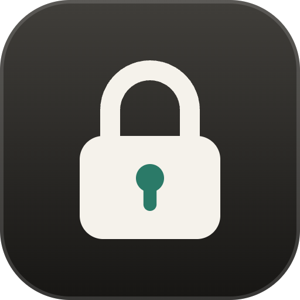
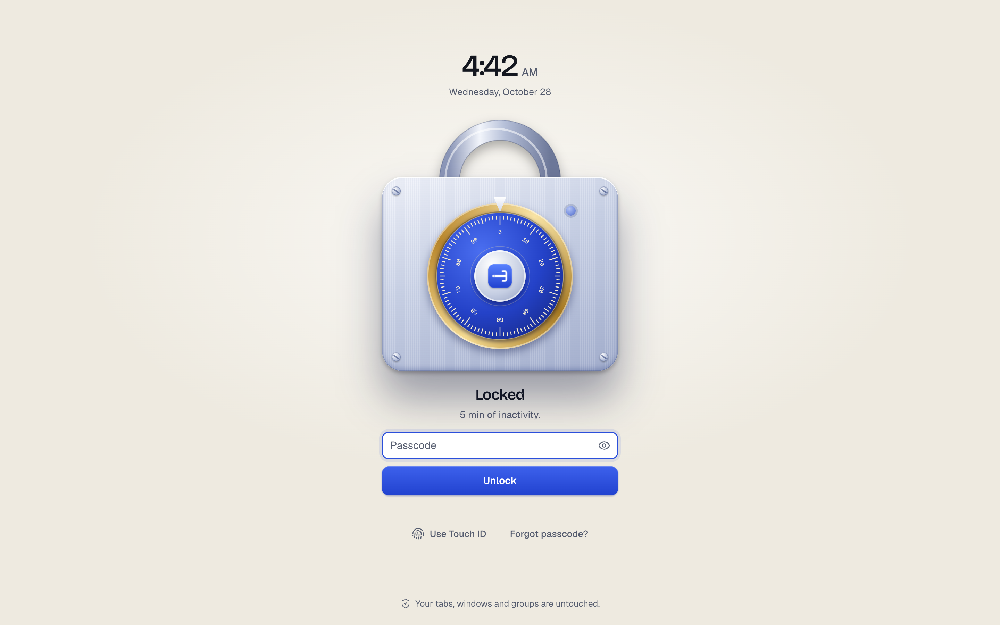
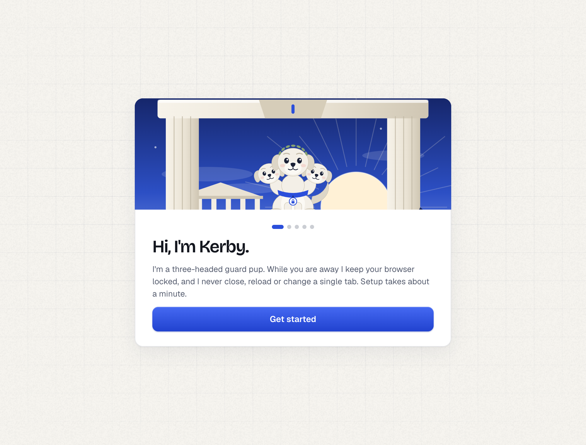
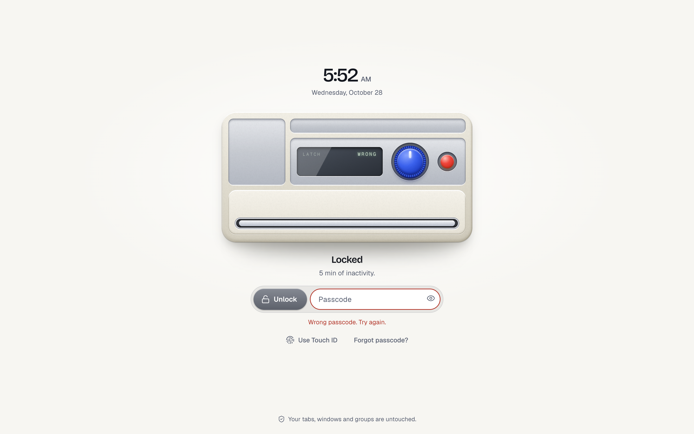
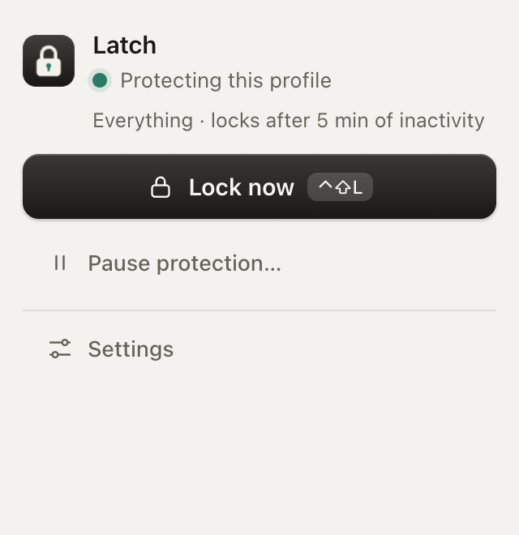

<p align="center">
  
</p>

<h1 align="center">Latch</h1>

<p align="center">
  <b>Lock Brave like Safari locks private windows.</b><br>
  A tiny passcode and Touch ID lock that covers your browser when you step away,<br>and never closes or changes a single tab.
</p>

<p align="center">
  <a href="https://rajveeerr.github.io/latch/">Website</a> ·
  <a href="#install-in-a-minute">Install</a> ·
  <a href="https://github.com/rajveeerr/latch/releases/latest">Download</a> ·
  <a href="docs/research.md">Research</a>
</p>

<p align="center">
  <a href="https://github.com/rajveeerr/latch/actions/workflows/test.yml"></a>
  
  
  
  
</p>

<p align="center">
  
</p>

## Why I built this

I always wanted a **native lock in Brave**, like the one Safari has for private windows. It never shipped.

So I used a lock extension. It crashed my browser at random and **lost my saved and grouped tabs** more than once. That was the last straw. I built the lock I wanted: fast like a native feature, light, secure, with the good features, and it **never closes or touches a tab**.

I was not alone. Brave's own tracker lists [password protection for tabs and profiles](https://github.com/brave/brave-browser/issues/42457) as P5, *"not on the official roadmap"*, and a community thread asking for [a password for the browser itself](https://community.brave.app/t/a-password-for-the-browser-itself/97057) has been running since December 2019. People wanted it for shared family PCs, guests and open desks, and they did not trust extensions that ask for many permissions. Latch asks for five, all explained below, and none of them reach the network.

## Who it is for

- You leave Brave open at home, at work or at school, and someone else could walk up to it.
- You share a computer with family or roommates and want your logins, history and tabs to stay yours.
- You have lost tabs to a lock extension before and never want to again.

## What you get

| | |
|---|---|
| **Passcode lock** that covers every page, pauses media and mutes tabs | **Touch ID** (beta) through WebAuthn, with your passcode always as backup |
| **Private windows only** mode, like Safari, so the rest of the browser stays open | **Auto-lock** after inactivity, in the background, on sleep or at startup |
| **Recovery code**, so a forgotten passcode never means removing the extension | **Activity log** of locks, unlocks and wrong guesses, on your computer only |
| **Aegis**, a three-headed guard pup who closes his eyes while you type and growls at a wrong guess | **Make it yours**: pick the lock screen (a combination lock or a trading card) and the mascot (Aegis, Kerby, or none) | **A lock screen that feels physical**: a brass combination lock whose dial turns as you type, whose lamp flashes red on a wrong guess, and whose shackle lifts when it opens | **Light and dark** that follow your system, in a calm native-feeling interface |

<p align="center">
  
  &nbsp;
  
  &nbsp;
  
</p>

## Install in a minute

Latch is not in a web store yet, so you load it as an unpacked extension.

1. [Download the latest zip](https://github.com/rajveeerr/latch/releases/latest) and unzip it somewhere permanent. The browser reads it from that folder, so do not delete it.
2. Open `brave://extensions` and switch on **Developer mode**.
3. Click **Load unpacked** and choose the unzipped folder (the one with `manifest.json` in it).
4. Aegis says hello. Pick a passcode and **save your recovery code**. Optionally, switch on **Allow in private** in the extension's details so private windows are covered too.

Latch locks the profile it is installed in. Install it in each profile you want to protect. `Control+Shift+L` locks instantly.

## Pair it with your Mac's lock

Latch covers your browser. macOS covers everything else. Press **Control + Command + Q** to lock your Mac whenever you step away, and in System Settings turn on *Require password immediately* after sleep or screen saver. Together they cover the whole machine.

## Light and fast

Measured on a MacBook with Chromium:

| | |
|---|---|
| Download | **207 KB** (fonts and art included) |
| Script on every web page | **5 KB**, which only draws a cover and reads nothing |
| Lock screen first paint | **~70 ms** (popup ~60 ms, settings ~90 ms) |
| Permissions | **5**: `storage`, `idle`, `alarms`, `scripting`, `tabGroups` (why: see below) |
| Network, accounts, analytics | **none** |

<details>
<summary><b>How it compares</b></summary>

Other lockers are worth knowing about: [Locksy](https://www.locksy.dev/) (per-tab and per-site locks), Chrome Lock Pro, [Secure Browser Lock](https://github.com/benjamindimalanta/secure-browser-lock) and Browserlock. Latch's angle is different: it never destroys state, it has a recovery path, it guides you into private windows, and it stays tiny. It does **not** (yet) do per-site locks, schedules or decoy PINs. The full notes, with sources, are in [docs/research.md](docs/research.md).

</details>

<details>
<summary><b>Why each permission</b></summary>

- `storage`: your settings and the hashed passcode, on this computer.
- `idle`: knowing when you have been away, or the screen locked.
- `alarms`: the timer for "locks after the browser has been in the background".
- `scripting` and all sites: puts the lock cover into tabs that were already open (a page script only loads in pages opened after an extension is installed). This is why the browser says Latch can "read and change data on all sites". It reads nothing and sends nothing.
- `tabGroups`: only for the optional strict mode, to put tab groups (name, colour, collapsed) back when it reopens windows.

</details>

<details>
<summary><b>How windows are hidden, and strict mode</b></summary>

**By default the lock sits on the window itself.** Every tab gets an opaque cover with the unlock screen in it, so you type the passcode right where your window is. Nothing opens, moves, minimizes or leaves full screen, so there is nothing to jump around, and your window sizes and positions stay exactly as they are. The unlock screen is a frame of one of Latch's own pages, so a website cannot read what you type; it is only loaded in the tab you are looking at. A window whose visible tab cannot hold a cover (the new tab page, `brave://` settings, the web store) is minimized instead, and if no window can hold the cover Latch opens a small unlock window, so there is always a way back in. Touch ID opens that small window too, because it is tied to Latch's own address.

The **tab strip and address bar stay visible** under an overlay, which a page cannot cover. If that matters more to you than staying put, turn off **Lock on the window itself** in settings: a separate lock window rises over the screen and this profile's windows are minimized (a full-screen window steps out of full screen first). On unlock the lock window closes first, normal windows return, full-screen windows re-enter full screen last, and focus goes back to the window you were using. Latch only ever sees and touches the profile it is installed in.

**Stage Manager and Mission Control** can show live thumbnails of windows that are not minimized. With the overlay, a thumbnail is a picture of the covered window, so it shows the lock screen and the tab strip, not your page (not yet checked on a real Stage Manager strip). Measured in Brave 156 with Stage Manager on: some windows stayed in the side strip as small thumbnails while locked, even after being asked to minimize again. Their pages show the lock cover, but the tab strip is still part of the picture. Setting **Lock window: full screen** puts the lock in its own Space, which is the best an extension can do (not yet confirmed to hide the strip). For a stricter result, macOS has an opt-in **Hide windows completely** switch: windows are closed while locked and reopened on unlock, so nothing shows anywhere. It never closes a window with unsaved typing or sound, saves what it closed before closing it, and reports anything it cannot reopen. It is riskier for your tabs than the default, which is why it is off. **Brave currently refuses it**: closing windows from an extension asks for confirmation on multi-tab windows and, in testing, crashed Brave 155 when repeated. Latch checks this when you switch it on. More on the options that were weighed: [docs/approaches.md](docs/approaches.md). What to test by hand: [docs/manual-tests.md](docs/manual-tests.md).

</details>

<details>
<summary><b>Honest limits</b></summary>

Latch is a **privacy lock for a browser you leave on a desk**, not a security boundary.

- **The install prompt will say Latch can read and change data on all sites.** That is how any extension covers pages: a 5 KB script runs on every page to draw the cover. It reads nothing and sends nothing, and the code is right here to check.
- It stops a casual passer-by, not someone with time, skill or a terminal. A browser extension cannot hide the tab strip, so the default overlay leaves tab titles and the address bar visible; the lock-window style hides more but moves windows.
- **Private windows only** mode is lighter protection: no lock window in front, just the page cover, which DevTools can remove.
- Anyone who can reach `brave://extensions` can remove Latch. Use your computer's own lock and a sign-in password too.
- The passcode hash lives in the profile folder. Use a long passphrase, not four digits.
- **Touch ID is beta.** The WebAuthn logic is tested with a virtual authenticator in Chromium and Brave, not yet on real Touch ID hardware in Brave.

</details>

<details>
<summary><b>Develop</b></summary>

```sh
npm install                  # only for the tests and the art scripts
npm test                     # 41 unit tests: passcode, recovery, WebAuthn, settings, safety rules
BRAVE=1 npm run test:e2e     # 19 end-to-end checks in real Brave with a throwaway profile
npm run zip                  # dist/latch-<version>.zip
node scripts/make-icons-sprite.mjs   # icons from Lucide
```

The safety test fails the build if any code closes, reloads, discards or navigates a tab, closes a window other than its own lock window, asks for more permissions or touches the network. Window behaviour is covered by `npm run test:windows` (18 cases across normal, maximized, half-screen, full screen, minimized, several windows, tabs and windows opened or closed while locked), `npm run test:profiles` (Latch never touches another profile) and `npm run test:autolock`. Aegis, the painted scene, the engraved poster and the combination lock are drawn in code (`ui/aegis.js`, `ui/scene.js`, `ui/poster.js`, `ui/lockdial.js`).

</details>

## Credits

Fonts: [Geist](https://github.com/vercel/geist-font) and [Bricolage Grotesque](https://github.com/ateliertriay/bricolage) (OFL). Icons: [Lucide](https://lucide.dev) (ISC). Built by [@rajveeerr](https://github.com/rajveeerr). [MIT](LICENSE).
